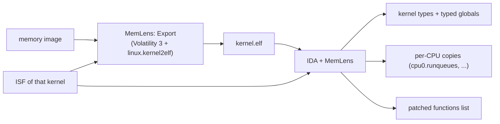

# MemLens

Reverse engineer a Linux kernel **as it was running**, from a memory image, in IDA.

**Before:** `trace.elf`, the 1 GB memory image of the demo VM (not part of the demo zip), is an ELF core: 5 `LOAD` segments at physical addresses, no symbol table, no code sections.

**After:** `kernel.elf`, an ordinary ELF: the kernel and its loaded modules at their live addresses, 234,081 symbols, one copy of the per-CPU variables per CPU. With the kernel's ISF, MemLens types it in IDA (every struct, union, enum and typed global) and lists the functions someone hooked. `objdump` excerpt of `kernel.elf` (`vfs_getattr`'s entry was rewritten by ftrace; the hook page was copied from memory):

```
ffffffff8e64e370 <vfs_getattr>:
ffffffff8e64e370:	endbr64
ffffffff8e64e374:	call   ffffffffc0b2b000 <memlens_target_ffffffffc0b2b000>
...
ffffffffc0b2b094:	call   ffffffff8e434a40 <function_trace_call>
```



- **`kernel.elf`**: the kernel and every loaded module at their real (KASLR) addresses, with a full symbol table. An ordinary ELF.
- **Every kernel type**: all structs, unions and enums from a Volatility 3 ISF, as one C header with exact layouts.
- **Typed globals**: kernel data symbols get their real type, so `init_task` becomes a `struct task_struct`.
- **Per-CPU variables, one copy per CPU**: each CPU's live copy (`cpu0.runqueues`, `cpu1.pcpu_hot`, ...), typed like the globals.
- **Patched kernel functions**: entries rewritten by ftrace, kprobes, BPF trampolines or hook code, and syscall slots that leave the handlers, with the hook's owner when the memory shows it (the BPF program, or the `ftrace_ops` and its callback; for a kprobe that is the kernel's kprobe layer, not the code that set the probe).

The full description of each is under [Details](#details).

## Status: read this first

**MemLens has not yet been run inside real IDA.** It was built without access to an IDA installation. What was verified, and how, is listed below: the ELF and the type header are checked with independent tools, including a real disassembler (Ghidra), but that is not IDA. The IDA-specific layer (`memlens_entry.py`) is small and was written against the official IDAPython sources, but it has only been exercised with fake `ida_*` modules; its 54 `ida_*` / `idc` names also exist in the stubs of IDA 9.1 to 9.5 (`tests/check_ida_names.py` on the PyPI `idapro` packages 0.0.5, 0.0.7, 0.0.9, 0.0.11 and 0.0.12). Bug reports are very welcome.


MemLens was built by an AI agent (Claude, operated by Nightshift Labs).

## Install

```
hcli plugin install memlens
pipx install volatility3==2.28.2
```

The plugin index can lag a day or more behind the [GitHub releases](https://github.com/nightshift-labs-ai/memlens/releases); if `hcli plugin status` shows an older version, install a release zip directly: `hcli plugin install https://github.com/nightshift-labs-ai/memlens/archive/refs/tags/v0.3.27.zip`.

Or copy this folder (from the latest release) into your IDA `plugins` directory. You also need an ISF symbol file for the kernel in the image; [dwarf2json](https://github.com/volatilityfoundation/dwarf2json) builds one from the kernel's debug package.

## Try it

No memory image or Volatility needed for steps 1-3. Download `memlens-demo-debian13.zip` from the [demo-data release](https://github.com/nightshift-labs-ai/memlens/releases/tag/demo-data) (22 MB). It holds a ready `kernel.elf` from a throwaway Debian 13 lab VM (68 MB, 234,081 symbols: 39,173 from modules and 776 per-CPU copies; a different capture of the same kernel than the table below), the matching ISF, and the expected output. A whole kernel is a large database, so IDA's auto-analysis and the type import take a while; we have not timed them in IDA.

1. Unzip it, then open `kernel.elf` in IDA.
2. **MemLens: Apply kernel types from ISF** and pick the `.json.xz` file.
3. **MemLens: Show patched kernel functions**. The lab VM's script set an ftrace filter on `vfs_getattr` and a kprobe on `do_sys_openat2`; a third patched entry, `bpf_lsm_file_open`, was not set by the script: its hook page is a BPF trampoline that runs the BPF program at `0xffffffffc0004664`, which an export made with this version names `bpf.bpf_prog_e8932b6bae2b9745_restrict_filesystems` (the demo zip holds an older export, without BPF names). All three should be listed as `call to memory with no symbol` (each entry calls a trampoline page that no module owns, copied in as `memlens_target_<address>`), and each label names the handler that page calls: `function_trace_call` (ftrace), `kprobe_ftrace_handler` (kprobe via ftrace) and `__bpf_tramp_enter` (a BPF trampoline), as in `expected-patched-functions.txt`. In the list, the Target column should show each hook page under its new name (`ftrace_tramp_vfs_getattr`, `kprobe_ftrace_tramp_do_sys_openat2`, `bpf_tramp_bpf_lsm_file_open`), the Handler column the function it calls, and the Owner column who put the hook there: `function_trace_call (ftrace_ops global_ops)`, `kprobe_ftrace_handler (ftrace_ops kprobe_ftrace_ops)` and `BPF program at 0xffffffffc0004664`. Enter should jump to the function, the list's Edit command (usually Ctrl+E) to the handler and its Insert command (usually Ins, captioned **Jump to owner**) to the owner; the keys are not checked in IDA.

### Export it yourself

The demo `kernel.elf` comes from `trace.elf`, a 1 GB memory image of the same VM. The image is public (80 MB compressed, in our [Volatility samples release](https://github.com/nightshift-labs-ai/volatility-2026-samples/releases/tag/samples)), so you can run the exporter on it too. From the unzipped demo folder, with this repository at `<memlens>`:

```
curl -LO https://github.com/nightshift-labs-ai/volatility-2026-samples/releases/download/samples/trace.elf.xz
xz -dk trace.elf.xz
python3 -m venv v && v/bin/pip install volatility3==2.28.2
mkdir -p symbols/linux out && cp debian-6.12.115+deb13.1-amd64.json.xz symbols/linux/
v/bin/vol -q -p <memlens>/vol_plugins -s symbols -o out -f trace.elf linux.kernel2elf.Kernel2Elf
python3 <memlens>/patchscan.py out/kernel.elf
```

On Windows the same steps in PowerShell would be the following (we have no Windows machine, so these lines are not tested; `7z` is 7-Zip):

```
curl.exe -LO https://github.com/nightshift-labs-ai/volatility-2026-samples/releases/download/samples/trace.elf.xz
7z x trace.elf.xz
py -m venv v; v\Scripts\pip install volatility3==2.28.2
mkdir symbols\linux, out; copy debian-6.12.115+deb13.1-amd64.json.xz symbols\linux\
v\Scripts\vol.exe -q -p <memlens>\vol_plugins -s symbols -o out -f trace.elf linux.kernel2elf.Kernel2Elf
py <memlens>\patchscan.py out\kernel.elf
```

Volatility 2.28.2 is the version we tested; the exporter uses Volatility's Linux module API, which newer releases may change.

The export takes about 25-50 s on our machine. With MemLens v0.3.27, `out/kernel.elf` is byte-identical to the demo's (its SHA-256 is in `SHA256SUMS.txt`). This version also writes the kernel's BPF names and the pages that hold the BPF programs, so its `out/kernel.elf` differs from the demo's (234,095 symbols instead of 234,081; 27.7 s here); the Volatility output lists the same three `patched` rows. In IDA, **MemLens: Export kernel from memory image** does the same: choose `trace.elf`, then the ISF from the demo folder. It runs Volatility's `vol` command from your PATH, or asks where it is (`v/bin/vol` above). The ELF is written next to the image (`kernel-1.elf` if a `kernel.elf` is already there).

## What you get (real output from the demo, not IDA screenshots)

We have no IDA, so there are no IDA screenshots. Below is real output for the demo `kernel.elf`, from the same code the plugin runs (`patchscan.py`, `isf2c.py`) and from binutils `objdump`.

Patched functions, the same scan the IDA list runs (`python3 patchscan.py kernel.elf`; it first prints `125660 function symbols scanned` on stderr, and its columns are tab-separated, aligned here for reading):

```
0xffffffff8e4f9250  bpf_lsm_file_open  call to memory with no symbol  memlens_target_ffffffffc0004940 (calls __bpf_tramp_enter, BPF trampoline)
0xffffffff8e642210  do_sys_openat2     call to memory with no symbol  memlens_target_ffffffffc0b2d000 (calls kprobe_ftrace_handler, kprobe via ftrace)
0xffffffff8e64e370  vfs_getattr        call to memory with no symbol  memlens_target_ffffffffc0b2b000 (calls function_trace_call, ftrace)
```

A hooked entry and the hook page it calls, which no module owns and which MemLens copied into the ELF (excerpts of `objdump -d --no-show-raw-insn --disassemble=vfs_getattr kernel.elf`, and the same with `do_sys_openat2`, `memlens_target_ffffffffc0b2b000` and `memlens_target_ffffffffc0b2d000`; a plain `objdump -d` prints the whole kernel, about 8.6 million lines; tabs shown as two spaces):

```
ffffffff8e64e370 <vfs_getattr>:
ffffffff8e64e370:  endbr64
ffffffff8e64e374:  call   ffffffffc0b2b000 <memlens_target_ffffffffc0b2b000>

ffffffffc0b2b000 <memlens_target_ffffffffc0b2b000>:
ffffffffc0b2b094:  call   ffffffff8e434a40 <function_trace_call>

ffffffff8e642210 <do_sys_openat2>:
ffffffff8e642210:  call   ffffffffc0b2d000 <memlens_target_ffffffffc0b2d000>

ffffffffc0b2d000 <memlens_target_ffffffffc0b2d000>:
ffffffffc0b2d0d9:  call   ffffffff8e294ed0 <kprobe_ftrace_handler>
```

So the `vfs_getattr` page is an ftrace trampoline and the `do_sys_openat2` page leads to the kprobe handler, readable at their live addresses.

The hook chain that **Show patched kernel functions** adds to the IDA database, as `python3 patchscan.py --links kernel.elf` prints it for the demo after the rows above (tab-separated, aligned here). The decisions are made in `patchscan.py`, so this is the same code the plugin runs:

```
xref    0xffffffff8e4f9254  0xffffffffc0004940  call  bpf_lsm_file_open+0x4 -> memlens_target_ffffffffc0004940
xref    0xffffffff8e642210  0xffffffffc0b2d000  call  do_sys_openat2 -> memlens_target_ffffffffc0b2d000
xref    0xffffffff8e64e374  0xffffffffc0b2b000  call  vfs_getattr+0x4 -> memlens_target_ffffffffc0b2b000
xref    0xffffffff8ff42660  0xffffffff8e434a40  data  global_ops -> function_trace_call
xref    0xffffffff900670e0  0xffffffff8e294ed0  data  kprobe_ftrace_ops -> kprobe_ftrace_handler
xref    0xffffffffc0004963  0xffffffff8e4cea70  call  memlens_target_ffffffffc0004940+0x23 -> __bpf_tramp_enter
xref    0xffffffffc0004993  0xffffffffc0004664  call  memlens_target_ffffffffc0004940+0x53 -> 0xffffffffc0004664
xref    0xffffffffc0b2b094  0xffffffff8e434a40  call  memlens_target_ffffffffc0b2b000+0x94 -> function_trace_call
xref    0xffffffffc0b2b0dd  0xffffffff8ff42660  data  memlens_target_ffffffffc0b2b000+0xdd -> global_ops
xref    0xffffffffc0b2d0d9  0xffffffff8e294ed0  call  memlens_target_ffffffffc0b2d000+0xd9 -> kprobe_ftrace_handler
xref    0xffffffffc0b2d162  0xffffffff900670e0  data  memlens_target_ffffffffc0b2d000+0x162 -> kprobe_ftrace_ops
rename  0xffffffffc0004940  memlens_target_ffffffffc0004940  bpf_tramp_bpf_lsm_file_open
rename  0xffffffffc0b2b000  memlens_target_ffffffffc0b2b000  ftrace_tramp_vfs_getattr
rename  0xffffffffc0b2d000  memlens_target_ffffffffc0b2d000  kprobe_ftrace_tramp_do_sys_openat2
owner   0xffffffffc0004940  0xffffffffc0004664  BPF program at 0xffffffffc0004664
owner   0xffffffffc0b2b000  0xffffffff8e434a40  function_trace_call (ftrace_ops global_ops)
owner   0xffffffffc0b2d000  0xffffffff8e294ed0  kprobe_ftrace_handler (ftrace_ops kprobe_ftrace_ops)
```

Each `xref` line becomes a cross-reference marked `XREF_USER`, which IDA's reanalysis does not delete. A `call` or `jmp` line is a code xref (`ida_xref.add_cref` with `fl_CN` or `fl_JN`): from the hooking instruction to the hook page, from the page's first named call to that function, and from a BPF trampoline's call to its program. A `data` line is a data xref (`ida_xref.add_dref` with `dr_O`): from an ftrace trampoline's `ftrace_ops` slot to the ops, and from the ops' `func` to the callback. Each `rename` line renames the page, and a comment there keeps the exporter's label and names the owner: `MemLens: hook page no module owns, copied from memory (exporter label memlens_target_ffffffffc0b2b000); reached from vfs_getattr; first named call: function_trace_call (ftrace); owner: function_trace_call (ftrace_ops global_ops)`. These three hooks are `call rel32`, so IDA's own analysis should find the same calls; the user xrefs matter most for absolute hooks (`movabs` + `jmp reg`, `push imm32; ret`, `jmp [rip+0]`), whose target IDA cannot see.

Each `owner` line is the page's Owner column (`-` when the owner is not in the ELF). The handler is the page's first named call when that call has a known role: ftrace, kprobe or BPF plumbing, or a module's function (a module callback, below); the owner is the code the hook page runs for whoever set the hook (for an ftrace-based kprobe that is the kprobe layer, `kprobe_ftrace_handler`, not the module that registered the probe):

- **ftrace trampoline:** the trampoline loads its `ftrace_ops` with `mov rdx, [rip+X]` from a slot the kernel stores right after the trampoline's `ret`. MemLens reads that pointer and the ops' `func` (its offset comes from the ISF, `--isf` or Apply kernel types, else 0, the offset in the Linux 6.1, 6.8, 6.12 and 7.0 ISFs we checked). That is the callback the ops registered, also when the trampoline calls `ftrace_ops_assist_func` instead, as the kernel does for ops flagged RECURSION or RCU. On the demo both ftrace owners are the kernel's own tracing (the function tracer and the kprobe layer). A module's hook through `ftrace_ops_assist_func` is tested on hand-made ELFs only (`tests/test_owner.py`), where the Owner column reads `evilmod.fh_ftrace_thunk (ftrace_ops evilmod.hooks+0x20)`. Ops outside the ELF are shown by address, as `ftrace_ops at 0x... (no symbol: heap)` or `(no symbol: module memory MemLens did not export)`. An ftrace trampoline whose callback is another kernel function, for example a livepatch's `klp_ftrace_handler`, is an ftrace page too: its Handler column reads `klp_ftrace_handler (ftrace)` and it is renamed `ftrace_tramp_<function>`.
- **BPF trampoline:** the program, which is the call right after `__bpf_prog_enter*`. MemLens follows the instructions the kernel's BPF JIT puts between the two; anything else there gives no owner. A kernel function in the program's place is not called a program: the interpreter reads `__bpf_prog_run32 (BPF interpreter: the program is not JIT-compiled)`, a cgroup LSM trampoline's shim `__cgroup_bpf_run_lsm_current (cgroup LSM shim: runs each cgroup's programs, not named here)`, anything else `<name> (called by the BPF trampoline)` (hand-made ELFs only). The demo `kernel.elf` has no BPF names, so it shows `BPF program at 0xffffffffc0004664`. An export made with this version also holds the kernel's BPF names (from Volatility's `Kallsyms` API) and the pages of every BPF program. On the demo image the owner is then `bpf.bpf_prog_e8932b6bae2b9745_restrict_filesystems (BPF program)`.
- **Module callback:** when the page's first named call is a module's function (`module.symbol`), the Handler and Owner columns both read, for example, `evilmod.fh_sys_kill (module callback)`, Jump to handler and Jump to owner go there, and the page is renamed `module_hook_` plus the hooked function (`module_hook___x64_sys_kill` for a hook on `__x64_sys_kill`), or plus the page's address when several functions share it. An ftrace trampoline that calls a module's callback itself (an ops not flagged RECURSION or RCU) is named this way too; its Owner still comes from its `ftrace_ops`. Tested on hand-made ELFs only (`tests/test_owner.py`, `tests/test_hookchain.py`, `tests/test_hookchain_stub.py`): none of our captures has such a page.
- **Otherwise:** a first call into the core kernel (`_printk`, `kfree`, a retpoline thunk) on a page that loads no `ftrace_ops` gives no handler and no owner: on a hidden module's page it is a helper the hook code uses. The Handler column reads `(hook code; first call: _printk)`, Jump to handler says that no handler is known instead of jumping into `_printk`, and the page keeps its `memlens_target_` label. The xref of that call is still added: it only repeats a real `call` instruction.

The list before and after, as the plugin code builds it for the demo (run with fake IDA modules by `tests/test_hookchain_stub.py`, not in IDA; columns separated by `|` and aligned here). Before this change:

```
Address          | Where             | What                          | Target
FFFFFFFF8E4F9250 | bpf_lsm_file_open | call to memory with no symbol | memlens_target_ffffffffc0004940 (calls __bpf_tramp_enter, BPF trampoline)
FFFFFFFF8E642210 | do_sys_openat2    | call to memory with no symbol | memlens_target_ffffffffc0b2d000 (calls kprobe_ftrace_handler, kprobe via ftrace)
FFFFFFFF8E64E370 | vfs_getattr       | call to memory with no symbol | memlens_target_ffffffffc0b2b000 (calls function_trace_call, ftrace)
```

After (Handler since v0.3.27, Owner since v0.3.28):

```
Address          | Where             | What                          | Target                             | Handler                                   | Owner
FFFFFFFF8E4F9250 | bpf_lsm_file_open | call to memory with no symbol | bpf_tramp_bpf_lsm_file_open        | __bpf_tramp_enter (BPF trampoline)        | BPF program at 0xffffffffc0004664
FFFFFFFF8E642210 | do_sys_openat2    | call to memory with no symbol | kprobe_ftrace_tramp_do_sys_openat2 | kprobe_ftrace_handler (kprobe via ftrace) | kprobe_ftrace_handler (ftrace_ops kprobe_ftrace_ops)
FFFFFFFF8E64E370 | vfs_getattr       | call to memory with no symbol | ftrace_tramp_vfs_getattr           | function_trace_call (ftrace)              | function_trace_call (ftrace_ops global_ops)
```

The Output window line from the same run: `[MemLens] hook chain: 3 patched entries lead into this database, 3 to a hook page MemLens copied; 7 code xrefs added; 4 data xrefs added; 3 hook pages renamed by role`. Run a second time, it made no `add_cref`, `add_dref` or `set_name` call. A fresh export of the Debian 13 hooks capture (the same three hooks at other KASLR addresses) gives the same counts, names and owners, with the program named `bpf.bpf_prog_e8932b6bae2b9745_restrict_filesystems`. On an Ubuntu 24.04 capture `patchscan.py --links` gives 1 entry, 3 xrefs, `bpf_tramp___hid_bpf_tail_call` and the owner `BPF program at 0xffffffffc0043958`; a fresh export names it `bpf.bpf_prog_7cc47bbf07148bfe_hid_tail_call`. None of our captures has a hook page that several functions share (one ftrace trampoline for many filters); MemLens then names the page by role and address (`ftrace_tramp_<address>`), which is tested on hand-made ELFs only.

Types, an excerpt of the header the plugin imports (`python3 isf2c.py debian-6.12.115+deb13.1-amd64.json.xz kernel_types.h`), with explicit padding so every offset matches the ISF:

```c
struct kstat {
  unsigned int result_mask;
  unsigned short mode;
  unsigned char __pad_6[2];
  unsigned int nlink;
  unsigned int blksize;
  unsigned long long attributes;
  ...
};
```

Typed globals come from the same ISF, for example `struct task_struct init_task`, `struct net init_net` and `struct static_key nf_hooks_needed[11][5]`. The ISF declares 79,316 typed globals for this kernel, but only those with a symbol in the ELF can be typed: 33,500 in the demo `kernel.elf`, plus 388 per-CPU variables, typed in each CPU's copy (`cpu0.runqueues`, `cpu1.runqueues`). Another 78 names that the ISF declares as variables are kernel functions here (`schedule`, `strlen`, ...): they are left alone, because typing code as data would break it. The other 45,350 have address 0 in the ISF (45,344) or an address outside exported memory (6, among them small assembler constants such as `vector`). The Output window says how many were typed and how many have no symbol in your database.


## Details

A memory image holds the live kernel: its modules and its patched code. In full:

- **`kernel.elf`**: the kernel image and every loaded module, at their real KASLR-adjusted addresses, with a full symbol table (module symbols are named `nf_tables.nft_do_chain`; a tool that does not allow `.` in names may show `_` instead). It is an ordinary ELF: binutils and Ghidra 12.2 load it with no custom loader, and IDA's own ELF loader is meant to open it the same way (not yet tried in IDA).
- **Every kernel type**: all structs, unions and enums from a Volatility 3 ISF, generated as one C header with exact layouts.
- **Typed globals**: kernel data symbols get their real type, so `init_task` becomes a `struct task_struct` (the declarations compile with gcc; applying them in IDA is part of the untested layer).
- **Per-CPU variables, one copy per CPU**: the kernel keeps a private copy of variables such as `runqueues` and the current task for every CPU. `kernel.elf` holds each CPU's live copy as section `.percpu.cpu<N>` (`.percpu.cpu<N>.0`, `.1`, ... if part of that area is missing from the image; a CPU whose area is missing entirely is left out), with symbols `cpu<N>.<name>` (`cpu0.runqueues`, `cpu1.pcpu_hot`, ...), and **Apply kernel types** types every copy. In the demo, `cpu0.pcpu_hot` (Linux 6.12; `cpu0.current_task` on 6.1 and 7.0) points to `init_task`, CPU 0's idle task, each CPU's `this_cpu_off` holds that CPU's own offset, and `cpu0.fixed_percpu_data` holds the stack canary. These areas sit below the kernel image, so Ghidra shows the lowest per-CPU address as the image base; IDA may do the same (not tried). `--no-percpu` on the command line writes the old layout, byte for byte.
- **A list of patched kernel functions**: named functions whose entry (or the instruction after `endbr64` or the NOP the kernel seals it with) was rewritten to a 5-byte `call`/`jmp` (ftrace and BPF trampolines, ftrace-based kprobes, calls into unmapped memory or from the kernel into a module) or to an `int3` breakpoint, or to an absolute-address hook (`jmp [rip+0]` + address, `movabs` + `jmp`/`call reg`, `push imm32; ret`; these also after the ftrace NOP), a `call`/`jmp` after the ftrace NOP or through a pointer in memory (`[rip+disp32]`) that lands in memory with no symbol or goes from the kernel into a module, plus syscall table slots that leave the handlers. Patches deeper inside a function are not found, and functions without a symbol are not checked. Enter should jump to the function. Hook code in memory that belongs to no module is copied into the ELF, so you can read it, and the list names the handler each copied hook page calls (ftrace, kprobe via ftrace, BPF trampoline). In IDA, MemLens also links the hook chain: a code cross-reference from each hooked entry to its hook page and from the page to its handler, a name for each copied hook page by its role (`ftrace_tramp_vfs_getattr`), a Handler column in the list and the list's Edit command (usually Ctrl+E) to jump to the handler. An Owner column says who put the hook there: the BPF program a BPF trampoline runs, or the `ftrace_ops` an ftrace trampoline loads and its callback. It comes with xrefs that lead there and the list's Insert command (**Jump to owner**). All of this is written against the IDAPython API and checked with fake IDA modules only.

## Usage

In IDA, with any database open (plugin menu entries need one), under **Edit > Plugins**:

1. **MemLens: Export kernel from memory image**: choose the image. `kernel.elf` is written next to it (`kernel-1.elf` if one is already there; the message names the file). MemLens asks for the ISF and hands it to Volatility (Cancel uses Volatility's own symbols path, which has no Linux ISFs after a plain pip install). If Volatility finds no kernel, the error dialog says which kernel the image holds, or that it holds none (see "When the export fails").
2. Open `kernel.elf` in IDA.
3. **MemLens: Apply kernel types from ISF**: choose the ISF. If its kernel banner differs from the one in the database, MemLens asks before importing anything. The Output window then says how many types IDA rejected, how many are missing and how many differ in size from the ISF.
4. **MemLens: Show patched kernel functions**: opens the list, adds a comment at each entry and links the hook chain: a code cross-reference from each hooked entry to its hook page and from the page to its handler, cross-references toward the page's owner (a code xref to the BPF program; data xrefs from an ftrace trampoline's `ftrace_ops` slot to the ops and from its `func` to the callback, read at the offset from the last ISF applied with Apply kernel types that has `ftrace_ops`, else 0), and a name by role for each copied hook page whose role is known (`ftrace_tramp_`, `kprobe_ftrace_tramp_`, `bpf_tramp_`, or `module_hook_` when the page's first named call is a module's function, plus the function, or plus the page's address when several functions share it). It renames a page once, and only while it still has its `memlens_target_<address>` label or no real name, so a name you gave it is kept; the old label stays in a comment at the page. What it added is recorded in the database (netnode `$ memlens.hooks`), so running it again adds nothing twice and does not put back an xref or name you removed. Enter jumps to the entry; the list's Edit command, captioned **Jump to handler** in its context menu (usually Ctrl+E in IDA; not checked in IDA), jumps to the handler (on a page with no known role, whose first named call is a core-kernel helper, it says so instead), and its Insert command, captioned **Jump to owner** (usually Ins; not checked in IDA), to the owner when it is in the database. If adding the chain fails, the list is still shown and the error is in the Output window (xrefs or names added before the error are not recorded, so a second run counts them again). If the input file is missing and you pick a kernel.elf that is not the file the database was made from (by SHA-256), it asks before writing anything. Not yet tried in IDA.

### When the export fails

Volatility 2.28.2 prints the same error, byte for byte, for a wrong ISF, for no ISF and for a file that is not a memory image ("A translation layer requirement was not fulfilled ... A symbol table requirement was not fulfilled"). After that error MemLens runs `vol -q -f <image> banners.Banners` (it reads the whole image: about 6 to 20 s for the 1 GB demo image on our machine, depending on load and on whether the file is already in the OS cache, so a larger image takes longer; Cancel stops it and the dialog still shows Volatility's error), reads the ISF's own `linux_banner`, and the dialog says which case it is:

- An ELF file that is not a core dump (for example the demo `kernel.elf`, ELF type EXEC): it is not a memory image, so no banner scan runs (banners.Banners would find the kernel's lines in a kernel file too). The dialog says to open a kernel file from disk in IDA directly and use Apply kernel types.
- The file is shorter than its own ELF or LiME headers say (ELF: the end of the last `PT_LOAD`; LiME: the chain of range headers): it is probably an incomplete copy, so copy or download it again. This is checked first and no banner scan runs, because banners.Banners silently misses kernel lines near the end of a cut file: on the first 125 MB of the demo `trace.elf` it lists only a variant of the line (`# SMP` for `#1 SMP`), though the kernel's own line is in that part.
- No `Linux version` line in the file: Volatility found no Linux kernel in it, so it is probably not a Linux memory image. The dialog lists what Volatility 2.28.2 reads (from its layer list and its file opener): raw images, LiME, 64-bit ELF core dumps, VMware `.vmem` (read as a raw image; its `.vmss` or `.vmsn` next to it is needed for the right layout), QEMU suspend images and Xen core dumps, and xz, gzip or bzip2 compressed copies of these (named `.xz`, `.gz` or `.bz2`; Volatility decompresses them itself, which is slow: `banners.Banners` on an xz copy of the demo image took 123 s here); AVML needs the snappy library.
- The ISF's line is not among the image's: the ISF was built for another kernel. Both are shown; with the Debian 12 ISF on the demo `trace.elf` (lines shortened here):
  ```
  ISF: Linux version 6.1.0-54-amd64 (debian-kernel@lists.debian.org) ... Debian 6.1.190-1 (2026-10-16)
  Image: Linux version 6.12.115+deb13.1-amd64 (...) #1 SMP PREEMPT_DYNAMIC Debian 6.12.115-2 (2026-11-01)
  Image: Linux version 6.12.115+deb13.1-amd64 (...) # SMP PREEMPT_DYNAMIC Debian 6.12.115-2 (2026-11-01)
  Image: Linux version 6.12.115+deb13.1-amd64 (...) #1 SMP PREEMPT_DYNAMIC Debian 6.12.115-2 (2026-11-01)1)
  ```
  An image can hold several such lines (the demo image has 4, 3 of them different), so up to 3 are shown, most frequent first. MemLens does not say which one is the running kernel.
- The ISF's line is among the image's: banners.Banners also lists copies of a line (for example `MESSAGE=<line>` in the systemd journal of an earlier boot), but Volatility only matches the line as the kernel stores it, followed by a newline and a NUL byte. So MemLens then looks for exactly those bytes in the image file (at most one more read of the file, 0.1 to 5 s for the 1 GB demo image here; Cancel stops it). Found: the ISF fits a kernel in the image and Volatility failed for another reason. Not found: the line is only a copy and the ISF was built for another kernel; the dialog lists the ISF's line among the image's, marked `(the ISF's, only a copy)`, also when it is not among the 3 most frequent. A compressed file (xz, gzip, bzip2, AVML, zip) cannot be checked this way, so the dialog then names both causes.
- No ISF chosen: the image's lines, so you know which ISF to get (next section).
- An AVML image that Volatility cannot read because the snappy library is missing: the dialog says so (Volatility's own warning).

These cases were run with real Volatility 2.28.2 (the demo `trace.elf` with a Debian 12 ISF and with none, the demo `kernel.elf` with the Debian 12 ISF, 50 MiB of random bytes with and without the right ISF, an AVML header without snappy, a LiME copy of `trace.elf` with a journal copy of the Debian 12 line planted in it, with the Debian 12 ISF, the first 110 MB and 125 MB of `trace.elf` and 125 MB of its LiME copy, with the right ISF) through the plugin's export code on fake IDA modules, not in real IDA.

### An ISF for your own image

The ISF must come from exactly the kernel that was running when the image was taken.

1. Find that kernel: `vol -q -f <image> banners.Banners` prints its `Linux version ...` line.
2. Get an ISF for that banner. A ready-made one may exist in the community collection [Abyss-W4tcher/volatility3-symbols](https://github.com/Abyss-W4tcher/volatility3-symbols) (Debian, Ubuntu, Kali, AlmaLinux, Rocky): grep your banner line in its [`banners/banners_plain.json`](https://github.com/Abyss-W4tcher/volatility3-symbols/raw/master/banners/banners_plain.json), which gives the ISF's download URL (since 2026-10-20 the ISFs are GitHub Release assets and the old `raw/master/<Distro>/...` paths stop working after 2026-11-21, so use the index). Otherwise build one with [dwarf2json](https://github.com/volatilityfoundation/dwarf2json) from the kernel's debug image: `dwarf2json linux --elf /usr/lib/debug/boot/vmlinux-<version> | xz > <version>.json.xz` (Debian: package `linux-image-<version>-dbg`; Ubuntu: `linux-image-unsigned-<version>-dbgsym` from ddebs.ubuntu.com).
3. Export with that ISF (step 1 above), then apply the same ISF (step 3).

### Without IDA

```
vol -p vol_plugins -s <symbols> -o <outdir> -f <image> linux.kernel2elf.Kernel2Elf [--no-percpu] [--no-modules]
python3 isf2c.py <isf.json.xz> kernel_types.h
python3 patchscan.py [--links] [--isf <isf.json.xz>] kernel.elf
```

`--links` also prints the cross-references, hook page names and owners that **Show patched kernel functions** adds in IDA. `--isf` reads the offset of `ftrace_ops.func` from that kernel's ISF (otherwise 0).

### Headless, with idalib

IDA 9.0 or newer; set up the `idapro` module as Hex-Rays describes. After `hcli plugin install memlens` the script is in the plugin's folder, `$IDAUSR/plugins/memlens` (by default `~/.idapro/plugins/memlens` on Linux and macOS, `%APPDATA%\Hex-Rays\IDA Pro\plugins\memlens` on Windows):

```
python3 ~/.idapro/plugins/memlens/tools/memlens_headless.py kernel.elf <isf.json.xz> [--no-analysis] [--any-kernel]
```

It opens `kernel.elf` as a database, applies the types (the per-CPU copies too), comments every patched entry, links the hook chain as the menu action does, prints the same report and patch list and saves the database. It calls the plugin's own functions; like the rest of the IDA layer it has only been run against fake modules (`tests/test_headless_stub.py`), not a real idalib.

## What was verified

Memory images were captured from QEMU guests; addresses differ per boot because of KASLR.

| Kernel | Symbols in ELF | From modules | Loaded by Ghidra 12.2: functions disassembled at the right address, per-CPU data at the ELF address |
|---|---|---|---|
| Debian 12, 6.1.0-54 | 152,142 | 30,700 | `linux_banner`, `nf_hook_slow`; `cpu0.current_task`, `cpu1.current_task`, `cpu0.runqueues` |
| Debian 13, 6.12.115 | 237,297 | 42,391 | `linux_banner`, `__x64_sys_read`, `nf_hook_slow`, `nf_tables.nft_do_chain`; `cpu0.pcpu_hot`, `cpu1.pcpu_hot`, `cpu0.runqueues` |
| Ubuntu 26.04, 7.0.0-38 | 317,512 | 37,167 | `linux_banner`, `nf_hook_slow`, `nf_tables.nft_do_chain`; `cpu0.current_task`, `cpu1.current_task`, `cpu0.runqueues` |

All three rows were re-measured on exports made with the current code (2026-11-11, per-CPU areas included) with `tests/ghidra/MemLensCheck.java` in Ghidra 12.2 headless (`-noanalysis`): Ghidra finds the per-CPU symbols at the same addresses as the ELF, inside their `.percpu.cpu<N>` sections (checked with `readelf`), and it lists 3 to 10 fewer symbols than the ELF holds (152,133, 237,287 and 317,509; not investigated).

Symbols whose address is not in exported memory are left out by design, so every symbol in the ELF points into a section. Module text, read-only data and data become separate sections with the right permissions, and LOAD segments never overlap (`tests/check_elf.sh`).

Checked with binutils and a short Python step, independently of this code (`tests/check_elf.sh`): canonical addresses in every segment, `linux_banner` reads back the true kernel version, and `__x64_sys_read`, `nf_hook_slow` and `nft_do_chain` disassemble to real function prologues where those symbols are present (`nf_tables` is not loaded in the demo capture, so the script reports it missing there).

Types are checked by compiling the generated header with gcc, asserting every struct size and member offset against the ISF, and compiling a declaration for every typed global (`tests/check_layout.py`):

| Kernel | Layout assertions | Global declarations | Result |
|---|---|---|---|
| Debian 12, 6.1.0-54 | 59,662 | 62,340 | all pass |
| Debian 13, 6.12.115 | 67,392 | 79,316 | all pass |
| Ubuntu 24.04, 6.8.0-147 | 81,563 | 86,362 | all pass |
| Ubuntu 26.04, 7.0.0-38 | 89,321 | 123,349 | all pass |

Global declarations are every typed global in the ISF, compiled as `extern` declarations; fewer can be applied in IDA (Debian 13 demo: 33,500 plus 388 per-CPU variables, see above). Counts are from the current code. The gcc run was made on an earlier build that also declared 15 to 20 globals named like C++ keywords (`new`, `class`, ...), which are now skipped.

Ghidra's C parser was run over the same header (`tests/ghidra/MemLensCheck.java`), after replacing `__int128` with a 16-byte struct, which Ghidra's parser does not know:

| Kernel | Struct and union sizes compared with the ISF | Missing | Wrong size |
|---|---|---|---|
| Debian 12, 6.1.0-54 | 9,965 | 0 | 0 |
| Debian 13, 6.12.115 | 11,451 | 0 | 0 |
| Ubuntu 26.04, 7.0.0-38 | 14,930 | 0 | 0 |

Neither gcc nor Ghidra accepting the header proves IDA's parser will; that is part of the untested layer. If IDA rejects a declaration, MemLens is written to bisect its batches, keep the rest, and report the rejected ones in the Output window; that relies on IDA ignoring a redeclaration when a batch is parsed again, which we have not been able to observe in IDA.

The patch scan is tested without IDA: `python3 tests/test_patchscan.py` builds small ELFs with each hook pattern, including the cases that must stay quiet (ftrace's own trampolines, unconverted `__fentry__` calls, tail calls to the kernel's own functions, compiler clones). `python3 tests/test_demo_injection.py kernel.elf` plants a data pointer in `sys_call_table[0]`, `vfs_read` in `[62]` and an unmapped address in `[217]` in a copy of the demo `kernel.elf`; all three are reported and the function rows do not change. On five real captures (Debian 12, Debian 13 clean and with ftrace, kprobe and BPF hooks set, Ubuntu 24.04, Ubuntu 26.04) the hooks we set are reported and the clean Ubuntu 26.04 kernel reports none. `python3 tests/test_isf_formats.py` reads the same ISF in the four forms Volatility accepts (`.json`, `.json.xz`, `.json.gz`, `.json.bz2`), `python3 tests/test_findpatches_stub.py` checks, on fake IDA modules, that the patch list on a file that is not a kernel (a stripped `/bin/ls`, and a small unstripped program it compiles with `cc` when one is installed) gives a warning instead of an empty list, and `python3 tests/test_export_failure_stub.py` replays real Volatility 2.28.2 output (`tests/fixtures/vol-2.28.2`) through the export action on fake IDA modules with a fake `vol`: the dialog for each failure above, Cancel during the export (no banner scan) and during the banner scan. `python3 tests/test_hookchain.py [kernel.elf ...]` checks the hook chain decisions in `patchscan.py` (hooking instruction, hook page, handler, names) on hand-made ELFs (every hook form MemLens reports, also after `endbr64` and the ftrace NOP, `movabs` with r8-r15, `jmp [rip+X]`; trampolines packed next to each other; a syscall slot pointing at a hook page; a page shared by two functions, aliases, name collisions, a page with a real symbol, an unknown handler, a first named call into the core kernel (no owner)) and on real exports (it knows the demo, Debian 13 and Ubuntu 24.04 hooks; an export with no hooks or other hooks is skipped with a note), and `python3 tests/test_hookchain_stub.py [kernel.elf]` checks, on fake IDA modules, the calls the plugin makes (`add_cref`, `add_dref` and `set_name` arguments, the Handler and Owner columns, the Enter, Edit and Insert callbacks (`OnSelectLine`, `OnEditLine`, `OnInsertLine`), a second run that adds nothing, a page the user renamed or unnamed, a name IDA refuses, the ISF's `ftrace_ops.func` offset). `python3 tests/test_owner.py [kernel.elf ...]` checks the owner on hand-made ELFs laid out like the kernel's trampolines: ftrace_ops in kernel data, in a module's data behind `ftrace_ops_assist_func`, on the heap and in unexported module memory; the slot after `ret`, `ret; int3`, a bare `ret` or a jump to the return thunk; a `func` offset from an ISF; BPF trampolines with a JIT'ed program, a named one, the interpreter, a cgroup LSM shim, two programs, an unpatched `je`, and code that does not match; a module's function as the first named call. It also checks real exports (the demo and Ubuntu 24.04 hooks), and `patchscan.py --links` and `--isf`. `python3 tests/test_kernel2elf_bpf.py` checks the exporter's BPF names (sign-extended, none at a hook target, torn entries with a negative or huge size left out) and pages, on fake `volatility3` modules.

## Limits

- x86-64 Linux only.
- Bitfields are kept as raw bytes, with their names and positions in a comment.
- Function pointers become `void *`.
- No function prototypes: an ISF gives functions no parameter types. Most kernels also carry BTF, which has them, and our companion plugin [btf2ida](https://github.com/nightshift-labs-ai/btf2ida) finds it inside `kernel.elf` and applies prototypes by name. Measured outside IDA on the demo `kernel.elf`: the BTF is found by carving in 0.3 s, holds 50,366 function prototypes, and matches 46,904 of the 51,116 kernel function symbols that have no module prefix, compiler suffix or `__pfx_` padding prefix (91.8%). Running both plugins on one database has not been tried in IDA.
- Kernel symbols that are not mapped in the image, such as freed init code, are left out.
- An ISF keeps one type per name, while the kernel has some same-named local structs. Where a type cannot fit its offset, the member is emitted as raw bytes with a comment.

## Credits

Author: Nightshift Labs (built by an AI agent, Claude). Please list the authors as "Nightshift Labs". Built on [Volatility 3](https://github.com/volatilityfoundation/volatility3) and its ISF format. MIT licensed.
