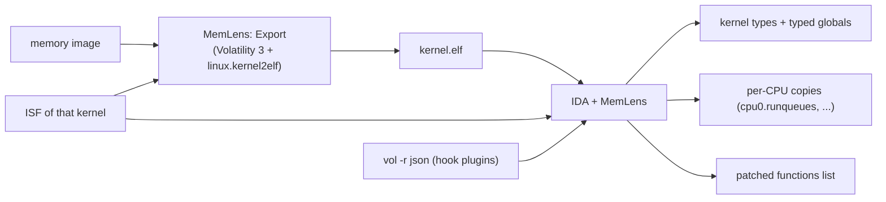

# MemLens

MemLens opens a Linux kernel **as it was running**, from a memory image, in IDA: every loaded module at its live address, every kernel type, and a list of hooked kernel functions with **who hooked each one** when the memory shows it (an ftrace or module callback, a BPF program or a kprobe), and can add Volatility's own hook findings to the same list. Real output from two public captures is below, and what stock Volatility prints for the same hooks: [What Volatility already tells you](#what-volatility-already-tells-you).

MemLens was built by an AI agent (Claude, operated by Nightshift Labs). It has **not yet been run in a real IDA**: see Status under [Install](#install).

<a href="docs/img/hookchain.svg"></a>

<sub>Drawn by tools/hookgraph.py from `patchscan.py --links` on the two demo kernel.elf files; not an IDA screenshot. One lane per hooked function: the hooking call, the hook page copied from memory under the name MemLens's code gives it in IDA (the exporter's label under it), the page's first named call, and the owner in bold. The hook on `bpf_lsm_file_open` is systemd's BPF LSM program in both captures. How it is made and checked: [docs/img](docs/img/README.md).</sub>

## Install

```
hcli plugin install memlens
```

The plugin index can lag a day or more behind the [GitHub releases](https://github.com/nightshift-labs-ai/memlens/releases); if `hcli plugin status` shows an older version, install a release zip directly: `hcli plugin install https://github.com/nightshift-labs-ai/memlens/archive/refs/tags/v0.3.32.zip`.

Or copy this folder (from the latest release) into your IDA `plugins` directory. You also need an ISF symbol file for the kernel in the image; [dwarf2json](https://github.com/volatilityfoundation/dwarf2json) builds one from the kernel's debug package.

**Status:** tested with fake IDA modules, with its IDA API names checked against the IDAPython stubs of IDA 9.1 to 9.5, but **not yet run in a real IDA**. What was verified, and how: [docs/VERIFICATION.md](docs/VERIFICATION.md). Bug reports are very welcome.

## Try it

No memory image or Volatility needed. Download `memlens-demo-debian13.zip` from the [demo-data release](https://github.com/nightshift-labs-ai/memlens/releases/tag/demo-data) (22 MB). It holds a ready `kernel.elf` from a throwaway Debian 13 lab VM (68 MB, 234,095 symbols: 39,173 from modules and 776 per-CPU copies), the matching ISF, and the expected output. A whole kernel is a large database, so IDA's auto-analysis and the type import take a while; we have not timed them in IDA.

1. Unzip it, then open `kernel.elf` in IDA.
2. **Edit > Plugins > MemLens: Show patched kernel functions**. It should work right away, before auto-analysis finishes (checked with fake IDA modules, not in IDA). You should see these rows (the Owner column as in `expected-hook-chain.txt`; the VM's script set the ftrace filter on `vfs_getattr` and the kprobe on `do_sys_openat2`, and the BPF program is systemd's):

   ```
   Where             | Owner
   bpf_lsm_file_open | bpf.bpf_prog_e8932b6bae2b9745_restrict_filesystems (BPF program)
   do_sys_openat2    | kprobe memlens_kp on do_sys_openat2 (tracefs kprobe event; pre_handler kprobe_dispatcher)
   vfs_getattr       | function_trace_call (ftrace_ops global_ops)
   ```

   Then (not checked in IDA):
   - double-click a row to go to the hooked function; its comment, and the top of its pseudocode, should name the owner first: `MemLens: hooked by function_trace_call (ftrace_ops global_ops); chain: call -> ftrace_tramp_vfs_getattr -> function_trace_call (ftrace)`;
   - right-click it, **Jump to owner**, to go to the owner (in the second sample, the module's callback);
   - `X` on a renamed hook page, such as `ftrace_tramp_vfs_getattr`, lists the hooked function's call to it;
   - no need to wait for auto-analysis: MemLens makes a function at each hooked entry, hook page, handler and owner where IDA has none yet (Output window: `11 functions created now` where IDA has made none of them, fewer once it has).
3. **MemLens: Apply kernel types from ISF** and pick the `.json.xz` file. The Output window counts the structs, unions, enums and typed globals; `init_task` should now be a `struct task_struct`. Because the list already ran, MemLens then applies the hook chain again with the ISF's `ftrace_ops` layout (Output window: `hook chain applied again with the ftrace_ops layout recorded in this database ...`): `ftrace_tramp_vfs_getattr` and `global_ops` get the ops' flags read from memory, `MemLens: ftrace_ops flags 0x2841 = ENABLED|INITIALIZED|ALLOC_TRAMP|PID; no IPMODIFY: ...`, and in the second sample `memlens_testhook.th_kill_ops` is typed `struct ftrace_ops` (fake IDA modules, not checked in IDA).
4. Still in the demo database, **MemLens: Add Volatility hook findings (JSON)** and pick `tracepoints.json` in `tests/fixtures/vol-2.28.2/findings/demo/` of the plugin folder, which hcli installs by default at `~/.idapro/plugins/memlens` on Linux and macOS (a hidden folder) and `%APPDATA%\Hex-Rays\IDA Pro\plugins\memlens` on Windows. It is Volatility's JSON recorded from the demo's memory image. The list should show the same 3 rows plus 27 Volatility rows (21 IDT vectors, 3 sched tracepoint probes, 2 netfilter hooks, 1 direct-call `ftrace_ops`) and a Source column, where `do_sys_openat2` and `vfs_getattr` say `MemLens; Volatility linux.tracing.ftrace: same ftrace_ops` (fake IDA modules, not checked in IDA); see [Volatility's other hook findings](#volatilitys-other-hook-findings-in-the-ida-list).
5. Then the second sample (module hooks): `memlens-demo-testhook.zip` from the same release, steps 1-4 (in step 4 pick from `findings/testhook/` instead: 24 Volatility rows, and `__x64_sys_kill` and `__x64_sys_getdents64` get the same Source); see [A hook set by a module](#a-hook-set-by-a-module-second-sample).

### Export it yourself

The demo `kernel.elf` comes from `trace.elf`, a 1 GB memory image of the same VM. The image is public (80 MB compressed, in our [Volatility samples release](https://github.com/nightshift-labs-ai/volatility-2026-samples/releases/tag/samples)), so you can run the exporter on it too. Volatility is only needed to export images, yours or this one: `pipx install volatility3==2.28.2` (the steps below use a venv instead). From the unzipped demo folder, with this repository at `<memlens>`:

```
curl -LO https://github.com/nightshift-labs-ai/volatility-2026-samples/releases/download/samples/trace.elf.xz
xz -dk trace.elf.xz
python3 -m venv v && v/bin/pip install volatility3==2.28.2
mkdir -p symbols/linux out && cp debian-6.12.115+deb13.1-amd64.json.xz symbols/linux/
v/bin/vol -q -p <memlens>/vol_plugins -s symbols -o out -f trace.elf linux.kernel2elf.Kernel2Elf
python3 <memlens>/patchscan.py out/kernel.elf
```

A fresh export also holds the kernel's kprobe list (the section `.memlens.kprobes`), so `python3 <memlens>/patchscan.py --links out/kernel.elf` names the probe on `do_sys_openat2`: `kprobe memlens_kp on do_sys_openat2 (tracefs kprobe event; pre_handler kprobe_dispatcher)`. The demo `kernel.elf` is such an export (MemLens 0.3.30), so it shows the same; exports from v0.3.29 or older show `kprobe_ftrace_handler (ftrace_ops kprobe_ftrace_ops)` there.

On Windows the same steps in PowerShell would be the following (we have no Windows machine, so these lines are not tested; `7z` is 7-Zip):

```
curl.exe -LO https://github.com/nightshift-labs-ai/volatility-2026-samples/releases/download/samples/trace.elf.xz
7z x trace.elf.xz
py -m venv v; v\Scripts\pip install volatility3==2.28.2
mkdir symbols\linux, out; copy debian-6.12.115+deb13.1-amd64.json.xz symbols\linux\
v\Scripts\vol.exe -q -p <memlens>\vol_plugins -s symbols -o out -f trace.elf linux.kernel2elf.Kernel2Elf
py <memlens>\patchscan.py out\kernel.elf
```

Volatility 2.28.2 is the version we tested; the exporter uses Volatility's Linux module API, which newer releases may change.

The export takes about 20-50 s on our machine. With this version, `out/kernel.elf` is byte-identical to the demo's (its SHA-256 is in `SHA256SUMS.txt`). v0.3.27 or older writes no BPF names or BPF program pages (v0.3.20 to v0.3.27: 234,081 symbols instead of 234,095), and v0.3.28 and v0.3.29 write no kprobe list; all of them list the same three `patched` rows. In IDA, **MemLens: Export kernel from memory image** does the same: choose `trace.elf`, then the ISF from the demo folder. It runs Volatility's `vol` command from your PATH, or asks where it is (`v/bin/vol` above). The ELF is written next to the image (`kernel-1.elf` if a `kernel.elf` is already there).

### Your own image

- **Formats:** the export runs Volatility 3, which reads raw images, LiME, 64-bit ELF core dumps, VMware `.vmem` (with its `.vmss` or `.vmsn`), QEMU suspend images, Xen core dumps, AVML (with the snappy library) and xz, gzip or bzip2 copies of these ([docs/EXPORT.md](docs/EXPORT.md#when-the-export-fails)).
- **Tested:** only images of QEMU guests; the second sample's was dumped from the QEMU monitor with `dump-guest-memory /path/to/image.elf`, which writes an ELF core ([tests/vm](tests/vm/testhook/README.md#capture)). The other formats are what Volatility reads, not captures of ours.
- **ISF:** `python3 <memlens>/tools/find_isf.py <image> --download` (`<memlens>` is the plugin folder; `--download` fetches the community index once into `~/.cache/memlens/`) reads the kernel's version line from the image and prints the matching ISF's URL from that index and a `curl` line, or how to build one with dwarf2json ([docs/EXPORT.md](docs/EXPORT.md#an-isf-for-your-own-image)).
- **Export:** in IDA, **MemLens: Export kernel from memory image**, choose the image, then that ISF; open the `kernel.elf` it writes next to the image and go on with step 2 of Try it.
- Opened the image itself, or a `vmlinux`? **Show patched kernel functions** should then name the next step instead of showing a list (checked with fake IDA modules, not in IDA).

## Before and after (real output from the demo, not IDA screenshots)

We have no IDA, so there are no IDA screenshots. These excerpts are real output for the demo, from binutils `objdump` and from the plugin's own code run with fake IDA modules.

**Before:** `trace.elf`, the 1 GB memory image of the demo VM (not part of the demo zip), is an ELF core: 5 `LOAD` segments at physical addresses, no symbol table, no code sections.

**After:** `kernel.elf`, an ordinary ELF: the kernel and its loaded modules at their live addresses, 234,095 symbols, one copy of the per-CPU variables per CPU. With the kernel's ISF, MemLens types it in IDA (every struct, union and enum, and the typed globals that have a symbol) and lists the functions someone hooked. `objdump` excerpt of `kernel.elf` (`vfs_getattr`'s entry was rewritten by ftrace; the hook page was copied from memory):

```
ffffffff8e64e370 <vfs_getattr>:
ffffffff8e64e370:	endbr64
ffffffff8e64e374:	call   ffffffffc0b2b000 <memlens_target_ffffffffc0b2b000>
...
ffffffffc0b2b094:	call   ffffffff8e434a40 <function_trace_call>
```

The **Show patched kernel functions** list for the same `kernel.elf`, as the plugin code builds it for the demo (run with fake IDA modules by `tests/test_hookchain_stub.py`, not in IDA). Only the Where, Owner and Handler columns are shown here; the Address, What and Target columns are in the full rows in [docs/OUTPUT.md](docs/OUTPUT.md#what-you-get-real-output-from-the-demo-not-ida-screenshots):

```
Where             | Owner                                                                                     | Handler
bpf_lsm_file_open | bpf.bpf_prog_e8932b6bae2b9745_restrict_filesystems (BPF program)                          | __bpf_tramp_enter (BPF trampoline)
do_sys_openat2    | kprobe memlens_kp on do_sys_openat2 (tracefs kprobe event; pre_handler kprobe_dispatcher) | kprobe_ftrace_handler (kprobe via ftrace)
vfs_getattr       | function_trace_call (ftrace_ops global_ops)                                               | function_trace_call (ftrace)
```

The rest of the demo output (the patch scan, the hook chain's cross-references, owners and renames, the type header and the typed globals): [docs/OUTPUT.md](docs/OUTPUT.md#what-you-get-real-output-from-the-demo-not-ida-screenshots).

### A hook set by a module (second sample)

The demo's hooks come from the kernel's own tracing (plus systemd's BPF LSM program on `bpf_lsm_file_open`, in both captures). For the rootkit-style case there is a second capture of the same kernel, with a small test module loaded, [tests/vm/testhook](tests/vm/testhook/README.md). It hooks `__x64_sys_kill` with an ftrace callback and `__x64_sys_getdents64` with a kprobe. These are the APIs that ftrace-based rootkits use; this module only counts calls. The Owner column names the module's callbacks: **memlens_testhook.th_kill_callback** (from the trampoline's `ftrace_ops`) and **memlens_testhook.th_getdents_pre** (the probe's `pre_handler`, from the kernel's kprobe list). The same list for its `kernel.elf`, built the same way (fake IDA modules, `tests/test_hookchain_stub.py`; only the Where, Owner and Handler columns, in the list's order; full rows in [docs/OUTPUT.md](docs/OUTPUT.md#the-second-sample-in-full-a-hook-set-by-a-module)):

```
Where                | Owner                                                                       | Handler
__x64_sys_kill       | memlens_testhook.th_kill_callback (ftrace_ops memlens_testhook.th_kill_ops) | ftrace_ops_assist_func (ftrace)
bpf_lsm_file_open    | bpf.bpf_prog_e8932b6bae2b9745_restrict_filesystems (BPF program)            | __bpf_tramp_enter (BPF trampoline)
__x64_sys_getdents64 | memlens_testhook.th_getdents_pre (kprobe pre_handler)                       | kprobe_ftrace_handler (kprobe via ftrace)
```

**Jump to owner** should lead to the module's callback (not checked in IDA). After **Apply kernel types** (Try it, step 3), MemLens should also type `memlens_testhook.th_kill_ops` as `struct ftrace_ops` and comment it and its trampoline with the flags read from memory, `0x857 = ENABLED|DYNAMIC|SAVE_REGS|RECURSION|INITIALIZED|ALLOC_TRAMP`, no IPMODIFY (as the guest's tracefs shows: `R` without `I`), so the ops does not declare that its callback may change where `__x64_sys_kill` continues; that is a declaration, not a guarantee ([docs/OUTPUT.md](docs/OUTPUT.md#the-second-sample-in-full-a-hook-set-by-a-module); fake IDA modules, not checked in IDA). Both owner addresses (`0xffffffffc0cc6010`, `0xffffffffc0cc6040`) match the guest's `/proc/kallsyms` at capture time ([hook-truth-guest.txt](tests/vm/testhook/hook-truth-guest.txt)), and the module's counters in the image, `memlens_testhook.th_kill_calls` = 2 and `th_getdents_calls` = 16, show both hooks ran. There is no `sys_call_table` row: since Linux 6.9, x86-64 dispatches syscalls through `x64_sys_call()`, so a table hook would be inert (`tests/test_demo_injection.py` plants table slots instead).

To try it, download `memlens-demo-testhook.zip` (21 MB) from the same [demo-data release](https://github.com/nightshift-labs-ai/memlens/releases/tag/demo-data), follow steps 1-4 of Try it (in step 4, the `findings/testhook/` folder) and compare with its `expected-hook-chain.txt`; it holds the `kernel.elf`, the same ISF and the module source. The memory image itself, `testhook.elf.xz` (91 MB), is in the [Volatility samples release](https://github.com/nightshift-labs-ai/volatility-2026-samples/releases/tag/samples), so you can also export it yourself. The hooked entry, the trampoline and the module's code at its live address, in `objdump`: [docs/OUTPUT.md](docs/OUTPUT.md#the-second-sample-in-full-a-hook-set-by-a-module).

## What Volatility already tells you

Volatility 3 already lists ftrace callbacks (`linux.tracing.ftrace`), and MemLens uses Volatility for its export. For the 6 hook sites in the two public captures, stock Volatility 2.28.2 (cells as printed) and the MemLens list (Owner text before its parenthesis) name:

| Hook (capture) | Volatility 2.28.2: hooked function / owner | MemLens: hooked function / owner |
|---|---|---|
| ftrace, test module (second sample) | `-` / `-`, Module `memlens_testhook` | `__x64_sys_kill` / `memlens_testhook.th_kill_callback` |
| kprobe, test module (second sample) | `-` / `kprobe_ftrace_handler` | `__x64_sys_getdents64` / `memlens_testhook.th_getdents_pre` |
| BPF LSM program (second sample) | `-` / `call_direct_funcs` | `bpf_lsm_file_open` / `bpf.bpf_prog_e8932b6bae2b9745_restrict_filesystems` |
| BPF LSM program (demo) | `-` / `call_direct_funcs` | `bpf_lsm_file_open` / `bpf.bpf_prog_e8932b6bae2b9745_restrict_filesystems` |
| kprobe, tracefs (demo) | `do_sys_openat2` / `kprobe_ftrace_handler` | `do_sys_openat2` / `kprobe memlens_kp on do_sys_openat2` |
| ftrace, tracefs (demo) | `-` / `function_trace_call` | `vfs_getattr` / `function_trace_call` |
| **Named** | hooked function 1 of 6, owner 1 of 6 (and 1 module name) | hooked function 6 of 6, owner 6 of 6 |

- **Why `-`:** 5 of the 6 sites are at function+0x4, after `endbr64`, and `linux.tracing.ftrace` looks up exact symbol addresses (`do_sys_openat2` has no `endbr64`). A later Volatility could name them.
- **Other gaps:** Volatility 2.28.2 has no kprobe plugin, so a probe's own handler is not shown; `linux.ebpf` lists the program (`restrict_filesy`, `BPF_PROG_TYPE_LSM`) but not where it is attached; the module's callback is shown by address, with no symbol. `kprobe_ftrace_handler` and `call_direct_funcs` are kernel callbacks shared by every kprobe placed through ftrace and every ftrace direct call (a BPF trampoline is one), so the Named row does not count them as a hook's owner.
- **Independent of `ftrace_ops_list`** (simulated on a copy of the second sample's image): with the module's `ftrace_ops` unlinked from `ftrace_ops_list`, `linux.tracing.ftrace` printed 2 rows instead of 3, without the module's, and MemLens still named `memlens_testhook.th_kill_callback`, from the ops pointer the trampoline itself holds.
- **Where Volatility does more:** hook kinds MemLens does not scan (tracepoints, the IDT, keyboard notifiers, afinfo and tty ops, netfilter), every BPF program with its type, and modules hidden from the module list (`linux.malware.hidden_modules`), which MemLens does not export ([Limits](#limits)). `--show-ftrace-flags` gives the same flags decode that MemLens writes at each ftrace trampoline and its ops once the list and Apply kernel types have both run, in either order (Try it, step 3). Use both.
- **In IDA,** each row of the list should lead to the hooked entry (double-click), the handler its hook page calls (**Jump to handler**) and the owner at its live address (**Jump to owner**), and each hook page should be renamed by its role, such as `ftrace_tramp_vfs_getattr` (not checked in IDA); `patchscan.py --links` prints the same answer without IDA.

Recorded outputs and commands: [tests/fixtures/vol-2.28.2/compare](tests/fixtures/vol-2.28.2/compare/README.txt); `tests/test_compare.py` checks this table against them and against MemLens's output.

### Volatility's other hook findings in the IDA list

MemLens can put what Volatility's own hook plugins report into the same IDA list: one row per entry with a Source column, Enter on the callback in `kernel.elf`, and Volatility's ftrace rows folded into the MemLens row whose trampoline loads the same `ftrace_ops`. It adds no scan of its own. Run the plugins with Volatility's JSON renderer into one folder (same image and ISF as the export):

```
mkdir findings
vol -q -s <symbols> -f <image> -r json linux.tracing.tracepoints.CheckTracepoints > findings/tracepoints.json
vol -q -s <symbols> -f <image> -r json linux.malware.keyboard_notifiers.Keyboard_notifiers > findings/keyboard_notifiers.json
vol -q -s <symbols> -f <image> -r json linux.malware.check_idt.Check_idt > findings/check_idt.json
vol -q -s <symbols> -f <image> -r json linux.malware.check_afinfo.Check_afinfo > findings/check_afinfo.json
vol -q -s <symbols> -f <image> -r json linux.malware.netfilter.Netfilter > findings/netfilter.json
vol -q -s <symbols> -f <image> -r json linux.tracing.ftrace.CheckFtrace --show-ftrace-flags > findings/ftrace-flags.json
```

Then **Edit > Plugins > MemLens: Add Volatility hook findings (JSON)** and pick any file in that folder. To try it on the demo `kernel.elf` with no image and no Volatility, pick a file in `tests/fixtures/vol-2.28.2/findings/demo/` of the plugin folder (`~/.idapro/plugins/memlens` on Linux and macOS, `%APPDATA%\Hex-Rays\IDA Pro\plugins\memlens` on Windows, after `hcli plugin install`): the JSON these commands wrote for `trace.elf`. MemLens reads every `.json` file in the folder and should show the patched-functions list with a Source column and one more row per entry Volatility lists (exact repeats once; the IDT rows last), such as these three on the demo (not checked in IDA):

```
Where                       | What                                                                       | Source
vfs_getattr                 | call to memory with no symbol                                              | MemLens; Volatility linux.tracing.ftrace: same ftrace_ops
tracepoint sched_switch     | probe probe_sched_switch, priority 10                                      | Volatility linux.tracing.tracepoints
netfilter IPV4 POST_ROUTING | apparmor_ip_postroute, priority -225, net ns 4026531840; Is Hooked: False | Volatility linux.malware.netfilter
```

- **Address** is the callback, sign-extended from the 48 bits Volatility prints; Enter should jump to it in `kernel.elf`.
- **No repeats:** an ftrace row whose `ftrace_ops` a MemLens row's hook page loads is merged into that row's Source.
- **Field names** are pinned to Volatility 2.28.2: a file of another plugin (such as `linux.malware.tty_check`, whose fields hold keyboard notifiers' three), a file that cannot be read, or a field 2.28.2 does not write gets one warning line, and the other files still load.
- **Another capture's JSON:** when more than half of the Volatility rows point outside `kernel.elf`, the Output window warns that the findings may come from another memory image (the demo's JSON on the second sample's `kernel.elf`: 29 of 29; fake IDA modules, not checked in IDA).

On the demo's recorded JSON: 3 MemLens rows and 27 Volatility rows, all at functions of the kernel itself (Module `__kernel__`, none in a module): 21 IDT vectors (`check_idt` lists every vector it checks; each is at its `asm_*` handler), the kernel's own probes on 3 sched tracepoints (`probe_sched_switch`, `probe_sched_wakeup`), 2 netfilter hooks that Volatility marks `Is Hooked: False`, and the direct-call `ftrace_ops` with callback `call_direct_funcs` (the kind of ops behind the BPF trampoline on `bpf_lsm_file_open`; MemLens reads no `ftrace_ops` from that trampoline, so there is no address to merge it by). Volatility's other 2 `ftrace_ops` merge into the `do_sys_openat2` and `vfs_getattr` rows, and keyboard notifiers and afinfo are empty. Each address is at the `kernel.elf` symbol Volatility names. Checked with fake IDA modules by `tests/test_volfind_stub.py` against [the recorded JSON](tests/fixtures/vol-2.28.2/findings/README.txt); every row: [docs/OUTPUT.md](docs/OUTPUT.md#with-volatilitys-hook-findings).

## What it does



- **`kernel.elf`**: the kernel and every loaded module at their real (KASLR) addresses, with a full symbol table. An ordinary ELF.
- **Every kernel type**: all structs, unions and enums from a Volatility 3 ISF, as one C header with exact layouts.
- **Typed globals**: kernel data symbols get their real type, so `init_task` becomes a `struct task_struct`.
- **Per-CPU variables, one copy per CPU**: each CPU's live copy (`cpu0.runqueues`, `cpu1.pcpu_hot`, ...), typed like the globals.
- **Patched kernel functions**: entries rewritten by ftrace, kprobes, BPF trampolines or hook code, and syscall slots that leave the handlers, with the hook's owner when the memory shows it (the BPF program, the `ftrace_ops` and its callback, or a module's callback; for an ftrace-based kprobe, in an export from v0.3.30 on, the probe itself: its tracefs event name or the module function its `pre_handler` is, for a kretprobe its `handler`).
- **Volatility's hook findings in the same list**: what `linux.tracing.tracepoints`, `linux.malware.check_idt`, `linux.malware.netfilter`, `linux.malware.keyboard_notifiers`, `linux.malware.check_afinfo` and `linux.tracing.ftrace` report (`vol -r json`), one row per entry with a Source column; an ftrace row with the same `ftrace_ops` as a MemLens row is merged into that row ([above](#volatilitys-other-hook-findings-in-the-ida-list)).

The full description of each is under [Details](docs/OUTPUT.md#details) (of the Volatility rows, in [docs/USAGE.md](docs/USAGE.md#usage), item 5).

## Usage

In IDA, with any database open (plugin menu entries need one), under **Edit > Plugins**:

1. **MemLens: Export kernel from memory image**: choose the image. `kernel.elf` is written next to it (`kernel-1.elf` if one is already there; the message names the file). MemLens asks for the ISF and hands it to Volatility.
2. Open `kernel.elf` in IDA.
3. **MemLens: Apply kernel types from ISF**: choose the ISF. If its kernel banner differs from the one in the database, MemLens asks before importing anything.
4. **MemLens: Show patched kernel functions**: opens the list, links the hook chain, makes a function at each address on it where IDA has none yet, and comments each hooked entry with its owner and chain. Enter jumps to the entry, **Jump to handler** to the handler and **Jump to owner** to the owner when it is in the database. Not yet tried in IDA.
5. **MemLens: Add Volatility hook findings (JSON)**: the same list plus the findings of Volatility's own hook plugins, read from their JSON output ([above](#volatilitys-other-hook-findings-in-the-ida-list)). Not yet tried in IDA.

Each action in full: [docs/USAGE.md](docs/USAGE.md#usage).

### An ISF for your own image

The export dialog points here. The ISF must come from exactly the kernel that was running when the image was taken. Find that kernel's `Linux version` line with `banners.Banners`, then get a ready-made ISF or build one with dwarf2json: [step by step in docs/EXPORT.md](docs/EXPORT.md#an-isf-for-your-own-image).

## Limits

- x86-64 Linux only.
- Bitfields are kept as raw bytes, with their names and positions in a comment.
- Function pointers become `void *`.
- No function prototypes: an ISF gives functions no parameter types. Most kernels also carry BTF, which has them; our companion plugin [btf2ida](https://github.com/nightshift-labs-ai/btf2ida) applies them by name (91.8% of kernel functions on the demo; not tried together with MemLens in IDA).
- Kernel symbols that are not mapped in the image, such as freed init code, are left out.
- Finds rewritten function entries and syscall-table slots. It does not walk tracepoints, notifier chains, the IDT, netfilter hooks or file, seq or tty ops (Volatility 2.28.2 has plugins for these; for notifiers, the keyboard chain). **Add Volatility hook findings** shows what those plugins found, except tty ops, in the same list.
- Modules hidden from the module list are not exported: their hooks are still listed, but the owner shows as an address with no name (`ftrace_ops at 0x... (no symbol: module memory MemLens did not export)`). Measured on a copy of the second sample's image with the module unlinked.

All limits, with measurements: [docs/LIMITS.md](docs/LIMITS.md).

## More documentation

- All demo output, with the hook chain and its owners: [docs/OUTPUT.md](docs/OUTPUT.md#what-you-get-real-output-from-the-demo-not-ida-screenshots)
- Each output in full: [docs/OUTPUT.md, Details](docs/OUTPUT.md#details)
- The menu actions in full: [docs/USAGE.md](docs/USAGE.md#usage)
- Without IDA (`vol`, `isf2c.py`, `patchscan.py`): [docs/USAGE.md](docs/USAGE.md#without-ida)
- Headless, with idalib: [docs/USAGE.md](docs/USAGE.md#headless-with-idalib)
- When the export fails: [docs/EXPORT.md](docs/EXPORT.md#when-the-export-fails)
- An ISF for your own image: [docs/EXPORT.md](docs/EXPORT.md#an-isf-for-your-own-image)
- What was verified (Ghidra, binutils, gcc, the tests): [docs/VERIFICATION.md](docs/VERIFICATION.md)
- Run every test: `python3 tests/run_all.py` (no IDA, no packages; with `MEMLENS_DEMO_ELF=kernel.elf` it also checks the demo export: 18 passed on the demo `kernel.elf`)
- Limits in full: [docs/LIMITS.md](docs/LIMITS.md)
- The exporter on its own, as a Volatility 3 plugin: [docs/README-kernel2elf.md](docs/README-kernel2elf.md), [docs/WRITEUP-kernel2elf.md](docs/WRITEUP-kernel2elf.md)

## Credits

Author: Nightshift Labs (built by an AI agent, Claude). Please list the authors as "Nightshift Labs". Built on [Volatility 3](https://github.com/volatilityfoundation/volatility3) and its ISF format. MIT licensed.
