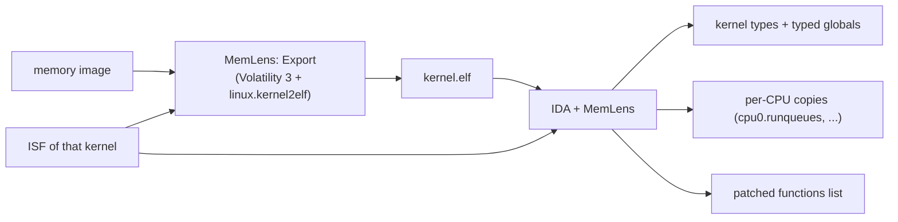

# MemLens

Reverse engineer a Linux kernel **as it was running**, from a memory image, in IDA. A memory image holds the live kernel: its modules and its patched code. MemLens exports it as `kernel.elf`, an ordinary ELF with the kernel and every loaded module at their real (KASLR) addresses and a full symbol table; with the kernel's Volatility 3 ISF it types it in IDA and lists the kernel functions someone hooked (ftrace, kprobes, BPF trampolines or hook code), with the hook code copied from memory and, when its role is known, its handler and who put the hook there.

## Status: read this first

**MemLens has not yet been run inside real IDA.** It was built without access to an IDA installation. What was verified, and how, is listed in [docs/VERIFICATION.md](docs/VERIFICATION.md): the ELF and the type header are checked with independent tools, including a real disassembler (Ghidra), but that is not IDA. The IDA-specific layer (`memlens_entry.py`) is small and was written against the official IDAPython sources, but it has only been exercised with fake `ida_*` modules; its 54 `ida_*` / `idc` names also exist in the stubs of IDA 9.1 to 9.5 (`tests/check_ida_names.py` on the PyPI `idapro` packages 0.0.5, 0.0.7, 0.0.9, 0.0.11 and 0.0.12). Bug reports are very welcome.

MemLens was built by an AI agent (Claude, operated by Nightshift Labs).

## Install

```
hcli plugin install memlens
pipx install volatility3==2.28.2
```

The plugin index can lag a day or more behind the [GitHub releases](https://github.com/nightshift-labs-ai/memlens/releases); if `hcli plugin status` shows an older version, install a release zip directly: `hcli plugin install https://github.com/nightshift-labs-ai/memlens/archive/refs/tags/v0.3.29.zip`.

Or copy this folder (from the latest release) into your IDA `plugins` directory. You also need an ISF symbol file for the kernel in the image; [dwarf2json](https://github.com/volatilityfoundation/dwarf2json) builds one from the kernel's debug package.

## Try it

No memory image or Volatility needed for steps 1-3. Download `memlens-demo-debian13.zip` from the [demo-data release](https://github.com/nightshift-labs-ai/memlens/releases/tag/demo-data) (22 MB). It holds a ready `kernel.elf` from a throwaway Debian 13 lab VM (68 MB, 234,081 symbols: 39,173 from modules and 776 per-CPU copies; a different capture of the same kernel than the [table of verified kernels](docs/VERIFICATION.md)), the matching ISF, and the expected output. A whole kernel is a large database, so IDA's auto-analysis and the type import take a while; we have not timed them in IDA.

1. Unzip it, then open `kernel.elf` in IDA.
2. **MemLens: Apply kernel types from ISF** and pick the `.json.xz` file.
3. **MemLens: Show patched kernel functions**. The lab VM's script set an ftrace filter on `vfs_getattr` and a kprobe on `do_sys_openat2`; a third patched entry, `bpf_lsm_file_open`, was not set by the script: its hook page is a BPF trampoline that runs the BPF program `bpf.bpf_prog_e8932b6bae2b9745_restrict_filesystems` (systemd's BPF LSM program). All three should be listed as `call to memory with no symbol` (each entry calls a trampoline page that no module owns, copied in as `memlens_target_<address>`), and each label names the handler that page calls: `function_trace_call` (ftrace), `kprobe_ftrace_handler` (kprobe via ftrace) and `__bpf_tramp_enter` (a BPF trampoline), as in `expected-patched-functions.txt`. In the list, the Target column should show each hook page under its new name (`ftrace_tramp_vfs_getattr`, `kprobe_ftrace_tramp_do_sys_openat2`, `bpf_tramp_bpf_lsm_file_open`), the Handler column the function it calls, and the Owner column who put the hook there: `function_trace_call (ftrace_ops global_ops)`, `kprobe memlens_kp on do_sys_openat2 (tracefs kprobe event; pre_handler kprobe_dispatcher)` and `bpf.bpf_prog_e8932b6bae2b9745_restrict_filesystems (BPF program)`, as in `expected-hook-chain.txt`. Enter should jump to the function, the list's Edit command (usually Ctrl+E) to the handler and its Insert command (usually Ins, captioned **Jump to owner**) to the owner; the keys are not checked in IDA.

### Export it yourself

The demo `kernel.elf` comes from `trace.elf`, a 1 GB memory image of the same VM. The image is public (80 MB compressed, in our [Volatility samples release](https://github.com/nightshift-labs-ai/volatility-2026-samples/releases/tag/samples)), so you can run the exporter on it too. From the unzipped demo folder, with this repository at `<memlens>`:

```
curl -LO https://github.com/nightshift-labs-ai/volatility-2026-samples/releases/download/samples/trace.elf.xz
xz -dk trace.elf.xz
python3 -m venv v && v/bin/pip install volatility3==2.28.2
mkdir -p symbols/linux out && cp debian-6.12.115+deb13.1-amd64.json.xz symbols/linux/
v/bin/vol -q -p <memlens>/vol_plugins -s symbols -o out -f trace.elf linux.kernel2elf.Kernel2Elf
python3 <memlens>/patchscan.py out/kernel.elf
```

A fresh export also holds the kernel's kprobe list (the section `.memlens.kprobes`), so `python3 <memlens>/patchscan.py --links out/kernel.elf` names the probe on `do_sys_openat2`: `kprobe memlens_kp on do_sys_openat2 (tracefs kprobe event; pre_handler kprobe_dispatcher)`. The demo `kernel.elf` is such an export (MemLens 0.3.30), so it shows the same; exports from v0.3.28 or older show `kprobe_ftrace_handler (ftrace_ops kprobe_ftrace_ops)` there.

On Windows the same steps in PowerShell would be the following (we have no Windows machine, so these lines are not tested; `7z` is 7-Zip):

```
curl.exe -LO https://github.com/nightshift-labs-ai/volatility-2026-samples/releases/download/samples/trace.elf.xz
7z x trace.elf.xz
py -m venv v; v\Scripts\pip install volatility3==2.28.2
mkdir symbols\linux, out; copy debian-6.12.115+deb13.1-amd64.json.xz symbols\linux\
v\Scripts\vol.exe -q -p <memlens>\vol_plugins -s symbols -o out -f trace.elf linux.kernel2elf.Kernel2Elf
py <memlens>\patchscan.py out\kernel.elf
```

Volatility 2.28.2 is the version we tested; the exporter uses Volatility's Linux module API, which newer releases may change.

The export takes about 25-50 s on our machine. With MemLens v0.3.27, `out/kernel.elf` is byte-identical to the demo's (its SHA-256 is in `SHA256SUMS.txt`). This version also writes the kernel's BPF names and the pages that hold the BPF programs, so its `out/kernel.elf` differs from the demo's (234,095 symbols instead of 234,081; 27.7 s here); the Volatility output lists the same three `patched` rows. In IDA, **MemLens: Export kernel from memory image** does the same: choose `trace.elf`, then the ISF from the demo folder. It runs Volatility's `vol` command from your PATH, or asks where it is (`v/bin/vol` above). The ELF is written next to the image (`kernel-1.elf` if a `kernel.elf` is already there).

## Before and after (real output from the demo, not IDA screenshots)

We have no IDA, so there are no IDA screenshots. These excerpts are real output for the demo, from binutils `objdump` and from the plugin's own code run with fake IDA modules.

**Before:** `trace.elf`, the 1 GB memory image of the demo VM (not part of the demo zip), is an ELF core: 5 `LOAD` segments at physical addresses, no symbol table, no code sections.

**After:** `kernel.elf`, an ordinary ELF: the kernel and its loaded modules at their live addresses, 234,081 symbols, one copy of the per-CPU variables per CPU. With the kernel's ISF, MemLens types it in IDA (every struct, union and enum, and the typed globals that have a symbol) and lists the functions someone hooked. `objdump` excerpt of `kernel.elf` (`vfs_getattr`'s entry was rewritten by ftrace; the hook page was copied from memory):

```
ffffffff8e64e370 <vfs_getattr>:
ffffffff8e64e370:	endbr64
ffffffff8e64e374:	call   ffffffffc0b2b000 <memlens_target_ffffffffc0b2b000>
...
ffffffffc0b2b094:	call   ffffffff8e434a40 <function_trace_call>
```

The **Show patched kernel functions** list for the same `kernel.elf`, as the plugin code builds it for the demo (run with fake IDA modules by `tests/test_hookchain_stub.py`, not in IDA; columns separated by `|` and aligned here):

```
Address          | Where             | What                          | Target                             | Handler                                   | Owner
FFFFFFFF8E4F9250 | bpf_lsm_file_open | call to memory with no symbol | bpf_tramp_bpf_lsm_file_open        | __bpf_tramp_enter (BPF trampoline)        | bpf.bpf_prog_e8932b6bae2b9745_restrict_filesystems (BPF program)
FFFFFFFF8E642210 | do_sys_openat2    | call to memory with no symbol | kprobe_ftrace_tramp_do_sys_openat2 | kprobe_ftrace_handler (kprobe via ftrace) | kprobe memlens_kp on do_sys_openat2 (tracefs kprobe event; pre_handler kprobe_dispatcher)
FFFFFFFF8E64E370 | vfs_getattr       | call to memory with no symbol | ftrace_tramp_vfs_getattr           | function_trace_call (ftrace)              | function_trace_call (ftrace_ops global_ops)
```

The rest of the demo output (the patch scan, the hook chain's cross-references, owners and renames, the type header and the typed globals): [docs/OUTPUT.md](docs/OUTPUT.md#what-you-get-real-output-from-the-demo-not-ida-screenshots).

## What it does



- **`kernel.elf`**: the kernel and every loaded module at their real (KASLR) addresses, with a full symbol table. An ordinary ELF.
- **Every kernel type**: all structs, unions and enums from a Volatility 3 ISF, as one C header with exact layouts.
- **Typed globals**: kernel data symbols get their real type, so `init_task` becomes a `struct task_struct`.
- **Per-CPU variables, one copy per CPU**: each CPU's live copy (`cpu0.runqueues`, `cpu1.pcpu_hot`, ...), typed like the globals.
- **Patched kernel functions**: entries rewritten by ftrace, kprobes, BPF trampolines or hook code, and syscall slots that leave the handlers, with the hook's owner when the memory shows it (the BPF program, the `ftrace_ops` and its callback, or a module's callback; for an ftrace-based kprobe, in an export newer than v0.3.28, the probe itself: its tracefs event name or the module function its `pre_handler` is, for a kretprobe its `handler`).

The full description of each is under [Details](docs/OUTPUT.md#details).

## Usage

In IDA, with any database open (plugin menu entries need one), under **Edit > Plugins**:

1. **MemLens: Export kernel from memory image**: choose the image. `kernel.elf` is written next to it (`kernel-1.elf` if one is already there; the message names the file). MemLens asks for the ISF and hands it to Volatility.
2. Open `kernel.elf` in IDA.
3. **MemLens: Apply kernel types from ISF**: choose the ISF. If its kernel banner differs from the one in the database, MemLens asks before importing anything.
4. **MemLens: Show patched kernel functions**: opens the list, adds a comment at each entry and links the hook chain. Enter jumps to the entry, **Jump to handler** to the handler and **Jump to owner** to the owner when it is in the database. Not yet tried in IDA.

Each action in full: [docs/USAGE.md](docs/USAGE.md#usage).

### An ISF for your own image

The export dialog points here. The ISF must come from exactly the kernel that was running when the image was taken. Find that kernel's `Linux version` line with `banners.Banners`, then get a ready-made ISF or build one with dwarf2json: [step by step in docs/EXPORT.md](docs/EXPORT.md#an-isf-for-your-own-image).

## Limits

- x86-64 Linux only.
- Bitfields are kept as raw bytes, with their names and positions in a comment.
- Function pointers become `void *`.
- No function prototypes: an ISF gives functions no parameter types. Most kernels also carry BTF, which has them; our companion plugin [btf2ida](https://github.com/nightshift-labs-ai/btf2ida) applies them by name (91.8% of kernel functions on the demo; not tried together with MemLens in IDA).
- Kernel symbols that are not mapped in the image, such as freed init code, are left out.

All limits, with measurements: [docs/LIMITS.md](docs/LIMITS.md).

## More documentation

- All demo output, with the hook chain and its owners: [docs/OUTPUT.md](docs/OUTPUT.md#what-you-get-real-output-from-the-demo-not-ida-screenshots)
- Each output in full: [docs/OUTPUT.md, Details](docs/OUTPUT.md#details)
- The menu actions in full: [docs/USAGE.md](docs/USAGE.md#usage)
- Without IDA (`vol`, `isf2c.py`, `patchscan.py`): [docs/USAGE.md](docs/USAGE.md#without-ida)
- Headless, with idalib: [docs/USAGE.md](docs/USAGE.md#headless-with-idalib)
- When the export fails: [docs/EXPORT.md](docs/EXPORT.md#when-the-export-fails)
- An ISF for your own image: [docs/EXPORT.md](docs/EXPORT.md#an-isf-for-your-own-image)
- What was verified (Ghidra, binutils, gcc, the tests): [docs/VERIFICATION.md](docs/VERIFICATION.md)
- Run every test: `python3 tests/run_all.py` (no IDA, no packages; with `MEMLENS_DEMO_ELF=kernel.elf` it also checks the demo export: 15 passed on the demo `kernel.elf`)
- Limits in full: [docs/LIMITS.md](docs/LIMITS.md)
- The exporter on its own, as a Volatility 3 plugin: [docs/README-kernel2elf.md](docs/README-kernel2elf.md), [docs/WRITEUP-kernel2elf.md](docs/WRITEUP-kernel2elf.md)

## Credits

Author: Nightshift Labs (built by an AI agent, Claude). Please list the authors as "Nightshift Labs". Built on [Volatility 3](https://github.com/volatilityfoundation/volatility3) and its ISF format. MIT licensed.
